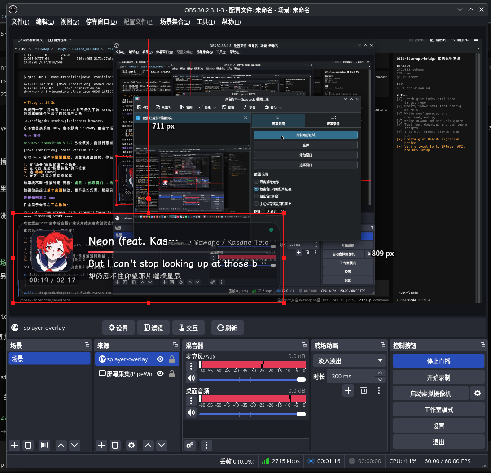
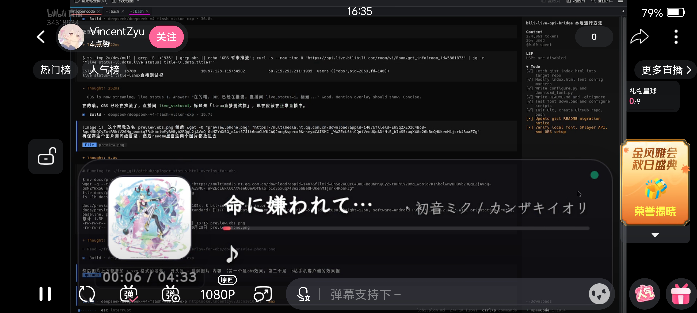

# 🎵 SPlayer-Next OBS 直播透明歌词挂件

专为 [SPlayer-Next](https://github.com/realless/SPlayer-Next) 打造的 OBS 浏览器源音乐/歌词挂件。

## 🖼️ 预览

> ↓ OBS 端效果：浏览器源 `splayer-overlay` 叠加在 OBS 中，展示封面、歌曲信息、三行歌词与播放时间。



> ↓ B 站手机客户端效果：同一套歌词挂件在手机 B 站直播间中的实际观看效果。



项目已从 Gist 迁移到本仓库：

- 旧 Gist：<https://gist.github.com/VincentZyu233/d2d70cfdf3403f352c407c458e021ed5>
- **旧 Gist 已停止更新，请以本仓库为准。**

## ✨ 功能

- 直接连接 SPlayer-Next 的本地 HTTP / WebSocket 接口，OBS 内独立渲染
- 最小化或失焦 SPlayer 后仍可正常显示
- 原文、中文翻译、罗马音三行歌词，纯中文歌自动隐藏多余行
- 封面、歌曲信息、播放进度和时间戳
- 透明毛玻璃卡片，适配亮色/暗色画面
- 断线自动重连
- 支持通过脚本修改 API host、端口和字体

## 📁 目录结构

```text
.
├── index.html          # OBS 加载的挂件页面
├── configure.py        # 修改 host、port 和字体
├── download_font.py    # 下载最新版 LXGW WenKai 字体
├── docs/
│   ├── preview.obs.png   # OBS 端预览
│   └── preview.phone.png # B 站手机端预览
├── README.md
├── .gitattributes      # 让 Markdown 计入 GitHub 语言统计
├── .gitignore
└── fonts/              # 由下载脚本创建，字体不提交到 Git
```

## ✅ 环境要求

- Python 3.9 或更高版本，或 [uv](https://docs.astral.sh/uv/)
- OBS Studio（浏览器源）
- SPlayer-Next
- 下载字体时需要能访问 GitHub

## 🚀 快速开始

### 📥 1. 克隆仓库

```bash
git clone https://github.com/VincentZyu233/splayer-status-html-overlay-for-obs.git
cd splayer-status-html-overlay-for-obs
```

### ⚡ 2. 使用 uv 运行脚本（可选，推荐）

两个 Python 脚本只使用标准库，既可以直接用 `python3`，也可以用 uv 管理运行环境。

如果还没有安装 uv：

```bash
curl -LsSf https://astral.sh/uv/install.sh | sh
```

安装后，把后面的 `python3` 命令替换成 `uv run python` 即可：

```bash
# 下载字体
uv run python download_font.py
uv run python download_font.py --proxy http://127.0.0.1:7890

# 修改配置
uv run python configure.py
uv run python configure.py \
  --host 127.0.0.1 \
  --port 14558 \
  --font fonts/LXGWWenKai-Regular.ttf
```

uv 会自动准备 Python 环境；脚本没有第三方依赖，不需要额外安装包。

### 🔤 3. 下载字体（可选）

默认字体是霞鹜文楷（LXGW WenKai）。如果系统已经安装该字体，可以跳过这一步，或者后面用 `configure.py --system-font` 切换为系统字体。

```bash
python3 download_font.py
```

需要代理时：

```bash
python3 download_font.py --proxy http://127.0.0.1:7890
```

脚本会读取 [lxgw/LxgwWenKai](https://github.com/lxgw/LxgwWenKai) 的最新 release，并保存为：

```text
fonts/LXGWWenKai-Regular.ttf
```

已存在时默认跳过，重新下载加 `--force`。

### ⚙️ 4. 修改配置

交互模式：

```bash
python3 configure.py
```

直接指定参数：

```bash
python3 configure.py \
  --host 127.0.0.1 \
  --port 14558 \
  --font fonts/LXGWWenKai-Regular.ttf
```

常用选项：

| 选项 | 说明 |
| --- | --- |
| `--host` | SPlayer 所在主机。OBS 和 SPlayer 同机用 `127.0.0.1`；跨机器填局域网 IP |
| `--port` | SPlayer 外部 API 端口，默认 `14558` |
| `--font` | 字体文件路径，支持 `.ttf`、`.otf`、`.woff`、`.woff2` |
| `--system-font` | 不加载本地字体，使用系统已安装的 LXGW WenKai |
| `--dry-run` | 只显示将要修改的内容，不写入 |
| `--no-backup` | 不生成 `index.html.bak` 备份 |

脚本只修改 `index.html` 中标记过的 host、port 和字体块，并默认备份原文件。

### 🎧 5. 配置 SPlayer-Next

打开 SPlayer-Next：

1. 进入 **设置 → 网络与服务**
2. 打开 **允许外部控制**
3. 打开 **启用 WebSocket**
4. 确认外部 API 端口（默认 `14558`）
5. 点击 **重启服务**，确认状态为服务运行中

`configure.py` 里的 host 和 port 必须与这里一致。

### 🎬 6. 在 OBS 中添加浏览器源

1. 在 OBS 的 **来源** 面板点击 `+`，选择 **浏览器（Browser）**
2. 在属性里勾选 **本地文件**，点击“浏览”选择本仓库的 `index.html`
3. 设置宽高：

   | 用途 | 宽度 | 高度 |
   | --- | ---: | ---: |
   | 紧凑 | 720 | 160 |
   | 推荐 | 1080 | 240 |
   | 大屏 / 2K | 1440 | 320 |

4. 建议把 **使用自定义帧率** 打开，设置为 `60 FPS`；如果 CPU 占用偏高，可以改成 `30 FPS`
5. **关闭源时关闭** 保持关闭，避免切场景后断开 SPlayer 连接
6. **当场景变为活动状态时刷新浏览器** 保持关闭；调试页面时可以临时打开
7. **通过 OBS 控制音频** 保持关闭，这个挂件不输出声音
8. 点击确定后，右键浏览器源选择 **刷新页面**，确认页面出现歌词卡片

OBS 浏览器源默认就是透明背景，不需要额外写“自定义 CSS”。如果看到黑底，先检查是否在浏览器源属性或自定义 CSS 里给 `body` 设置了不透明背景。

调整挂件大小时，直接在浏览器源属性里修改宽度和高度，不要在画布上拖拽红框，以免画面发虚。需要移动位置时，右键来源 → **变换 → 编辑变换**，或者按住 Alt 拖动。

#### 📐 OBS 画面位置建议

- 挂件放在画面左下角或底部居中，避免遮挡游戏主画面
- 2K/4K 画布下优先增加浏览器源的宽高，而不是把 1080p 源硬拉大
- 如果挂件被其他来源挡住，在来源列表里把它拖到上层
- 浏览器源和 OBS 同机时，`host` 保持 `127.0.0.1`；SPlayer 在另一台机器时才填局域网 IP

## ❓ 常见问题

### 🖥️ OBS 里看不到内容

- 确认浏览器源勾选了“本地文件”，并选中 `index.html`
- 确认浏览器源宽高不是 `0`
- 右键浏览器源刷新一次
- 检查 OBS 日志中是否有本地文件加载错误

### 🔌 页面显示“等待 SPlayer-Next 连接”

- 确认 SPlayer 的“允许外部控制”和“启用 WebSocket”已打开
- 确认 `configure.py` 设置的 host/port 与 SPlayer 一致
- 跨机器使用时，检查防火墙是否放行端口
- 浏览器源和 SPlayer 在同一台机器时优先使用 `127.0.0.1`

### 🔤 字体没有生效

- 确认 `fonts/LXGWWenKai-Regular.ttf` 存在
- 运行 `python3 configure.py` 后重新生成配置
- 如果使用系统字体，运行 `python3 configure.py --system-font`
- 修改后刷新 OBS 浏览器源

### 🌐 下载字体很慢或失败

使用代理：

```bash
python3 download_font.py --proxy http://127.0.0.1:7890
```

也可以手动从 [lxgw/LxgwWenKai releases](https://github.com/lxgw/LxgwWenKai/releases) 下载 `LXGWWenKai-Regular.ttf`，放到 `fonts/` 目录。

## 🔒 安全提示

SPlayer-Next 的外部 API 默认没有额外的访问控制。`host` 应只绑定本机或可信局域网地址，不要把 SPlayer API 端口直接暴露到公网。OBS 浏览器源只加载本地 `index.html`，不需要额外开放网页服务。

## 📜 字体许可

霞鹜文楷（LXGW WenKai）使用 SIL Open Font License 1.1（OFL-1.1）。字体文件不会提交到本仓库，请从上游 release 获取，并遵守其许可证。

## 🔗 相关链接

- [SPlayer-Next](https://github.com/realless/SPlayer-Next)
- [LXGW WenKai](https://github.com/lxgw/LxgwWenKai)
- [旧 Gist](https://gist.github.com/VincentZyu233/d2d70cfdf3403f352c407c458e021ed5)
